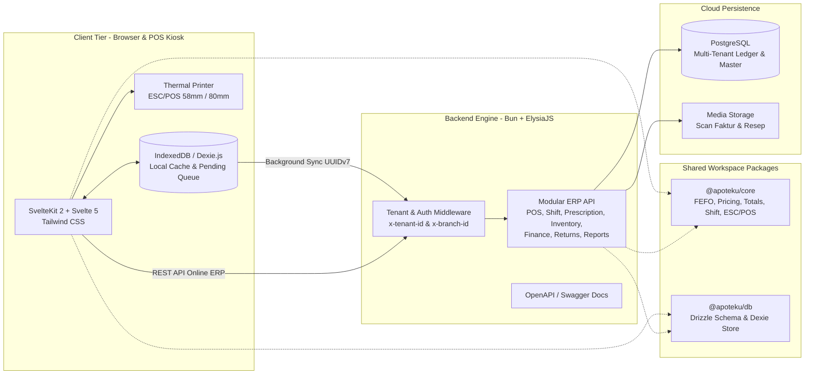
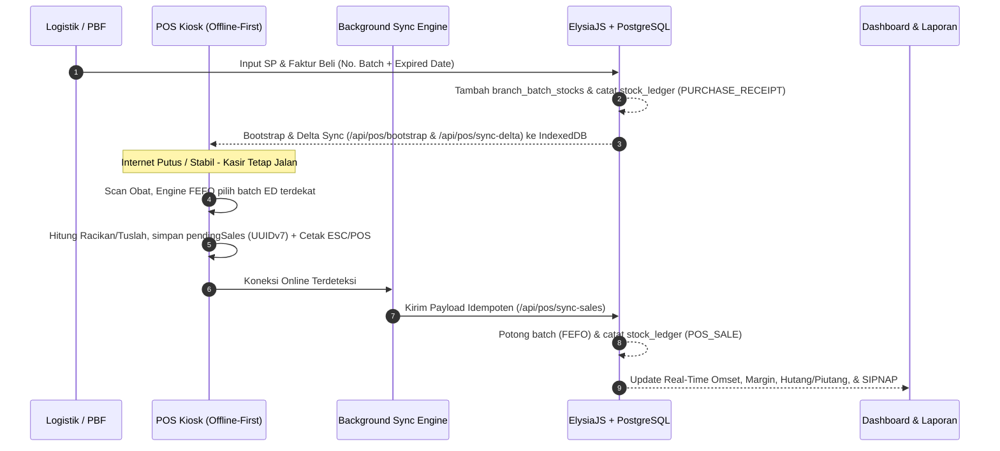

<div align="center">

# 💊 Apoteku • Offline-First Pharmacy ERP & POS SaaS

**Platform Manajemen Apotek Modern Berbasis Cloud & Offline-First untuk Ekosistem Farmasi Indonesia**

[]()
[]()
[]()
[]()
[]()

*Satu arsitektur terpadu untuk ribuan apotek: tangguh tanpa internet di meja kasir, presisi dalam audit BPOM & Kemenkes di back-office.*

[Jelajahi Showcase & Karya Lainnya → **semangkamedia.github.io**](https://semangkamedia.github.io) · [Profil & Portofolio Engineer → **abukafa.github.io**](https://abukafa.github.io)

</div>

---

## ✨ Ringkasan Eksekutif

**Apoteku** adalah produk **Software-as-a-Service (SaaS)** yang dirancang khusus untuk menstandarkan operasional apotek modern dan jaringan klinik di Indonesia - mulai dari apotek independen hingga jaringan multi-cabang.

Berangkat dari masalah klasik di lapangan (koneksi internet kasir tidak stabil, selisih stok batch kadaluwarsa, hingga rumitnya pelaporan regulasi **SIPNAP** dan audit **BPOM**), Apoteku menggabungkan kecepatan *native-feel* **Offline-First POS** dengan kekuatan **Cloud Multi-Tenant ERP**. Saat ini, Apoteku telah **dipesan (*pre-order*) oleh 5+ calon tenant apotek** menjelang peluncuran komersialnya di Indonesia.

---

## 🧠 Konsep & Filosofi Desain

| Pilar | Pendekatan Teknis | Dampak Bisnis di Apotek |
| :--- | :--- | :--- |
| **Offline-First Kiosk POS** | Penyimpanan lokal browser via **IndexedDB (Dexie.js)** + antrean sinkronisasi idempoten berbasis `UUIDv7`. | Transaksi kasir tetap berjalan 100% instan meski internet mati total, tanpa kehilangan data nota. |
| **Strict Multi-Tenancy** | Isolasi data logis di level middleware dan skema database (`tenant_id` & `branch_id`). | Satu *deployment* SaaS mampu melayani banyak apotek dan multi-outlet secara aman dan terpisah. |
| **Regulasi & FEFO Built-in** | Pemilihan stok otomatis *First Expired, First Out* (FEFO) & *Double-Entry Stock Ledger* permanen. | Meminimalkan kerugian obat kadaluwarsa serta menjamin keterlacakan mutasi batch untuk audit BPOM. |
| **Shared Domain Engine** | Kalkulasi harga bertingkat, konversi multi-satuan, tuslah/embalase, dan ESC/POS dikemas di `@apoteku/core`. | Logika bisnis 100% konsisten antara perhitungan *offline* di browser dan validasi *server* di backend. |

---

## 🏗️ Arsitektur Sistem & Monorepo

Apoteku dibangun dengan arsitektur **Modular Monorepo** menggunakan **Bun Workspaces** dan **Turborepo** untuk memisahkan antarmuka reaktif, *API engine* berkecepatan tinggi, kontrak skema database, dan *domain logic* murni.



### Struktur Monorepo

```text
apoteku/
├── apps/
│   ├── web/          # SvelteKit 2 + Svelte 5 (Dashboard, POS Kiosk, ERP Back-Office)
│   └── backend/      # Bun + ElysiaJS High-Performance API, Swagger, & Static Media
└── packages/
    ├── core/         # Pure TypeScript Domain Engine (FEFO, Harga, Shift, ESC/POS Builder)
    └── db/           # Single Source of Truth: PostgreSQL Drizzle Schema & Dexie Client DB
```

---

## 🔄 Alur Data Utama (*Data Flow*)

Alur data dirancang untuk menjembatani kecepatan kasir *real-time* dengan ketertiban pembukuan *back-office* tanpa proses input ganda:



---

## 🛠️ Tech Stack

| Layer | Teknologi | Peran Utama |
| :--- | :--- | :--- |
| **Runtime & Monorepo** | **Bun 1.4**, **Turborepo**, TypeScript | Eksekusi super cepat, manajemen workspace, dan *type-safety* ujung-ke-ujung. |
| **Frontend & UI** | **SvelteKit 2**, **Svelte 5 (Runes)**, Tailwind CSS, Lucide Icons | Antarmuka POS & ERP yang sangat ringan, reaktif, dan ramah perangkat kasir spesifikasi standar. |
| **Offline Engine** | **Dexie.js (IndexedDB)**, `UUIDv7` | Penyimpanan katalog lokal, cache stok batch, dan antrean transaksi offline tahan banting. |
| **Backend API** | **ElysiaJS**, TypeBox, `@elysiajs/swagger` | API modular berlatensi rendah dengan dokumentasi OpenAPI otomatis. |
| **Database & ORM** | **PostgreSQL**, **Drizzle ORM**, `postgres` | Skema relasional multi-tenant yang ketat untuk stok ledger, batch, akuntansi kas, dan audit. |
| **Hardware & Export** | Custom **ESC/POS Builder**, Native CSV & Print PDF | Cetak struk thermal 58mm/80mm langsung dari browser & ekspor laporan resmi. |

---

## 🚀 Fitur Unggulan

### 1. Kasir POS & Farmasi Klinis
- **Mode Kiosk Offline-First**: Mendukung penuh transaksi tanpa internet dengan *auto-sync* transparan.
- **Multi-Satuan & Harga Bertingkat**: Satu item mendukung satuan *Box / Strip / Tablet* dengan harga otomatis untuk kategori **Umum, Resep, Grosir, Delivery, dan Member**.
- **Racikan & Biaya Farmasi**: Perhitungan komponen bahan racikan (puyer/kapsul/salep), biaya **Tuslah**, dan **Embalase** secara otomatis.
- **Cetak Etiket & Salinan Resep**: Cetak etiket obat dalam (Putih) & obat luar (Biru) lengkap dengan aturan pakai (*signa*) serta *Copy Resep* (*Apograph*).

### 2. Pengendalian Stok & Logistik PBF
- **Algoritma FEFO Otomatis**: Sistem memprioritaskan pengurangan stok dari nomor batch dengan tanggal kadaluwarsa terdekat.
- **Double-Entry Stock Ledger**: Setiap mutasi (`POS_SALE`, `PURCHASE_RECEIPT`, `TRANSFER_IN/OUT`, `ADJUSTMENT`) tercatat permanen layaknya buku besar untuk keperluan audit BPOM.
- **Siklus Pengadaan Lengkap**: Surat Pesanan (SP Reguler/Narkotika/Psikotropika), Penerimaan Faktur PBF, Konsinyasi, Retur Beli/Jual, hingga **Mutasi Antar-Cabang** dengan verifikasi selisih (*discrepancy*).

### 3. Keuangan, Shift & Regulasi
- **Manajemen Shift & Rekonsiliasi Kas**: Buka/tutup shift kasir dengan kontrol modal awal, rekap tunai vs non-tunai (QRIS/Debit/Transfer/Tempo), hingga *cash count* fisik.
- **Buku Hutang PBF & Piutang Pasien**: Pelacakan jatuh tempo faktur distributor dan pembayaran tempo pelanggan.
- **Laporan Siap Lapor & Analitik**: Ekspor laporan bulanan **SIPNAP Kemenkes**, **Analisis Pareto ABC (70/20/10)**, rekap margin penjualan, serta dashboard KPI eksekutif.

---

<div align="center">

### 🔍 Tertarik Menggali Lebih Dalam?

Lihat studi kasus arsitektur, demo produk SaaS lainnya, dan catatan teknis di balik pengembangan proyek ini:

[**🌐 Kunjungi Semangka Media Showcase → `semangkamedia.github.io`**](https://semangkamedia.github.io)

[**👨‍💻 Jelajahi Portofolio & Engineering Notes → `abukafa.github.io`**](https://abukafa.github.io)

---

<sub>Built with precision for the Indonesian Healthcare & Pharmacy Ecosystem · Apoteku SaaS</sub>

</div>
